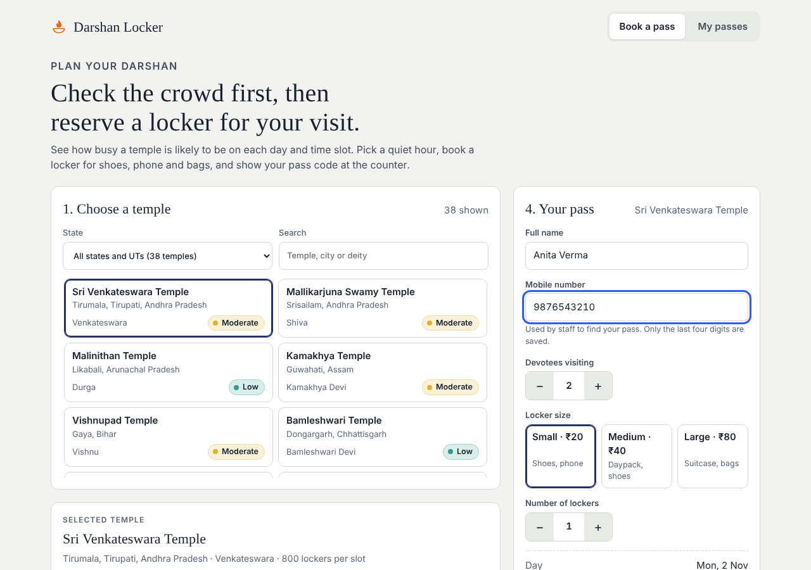
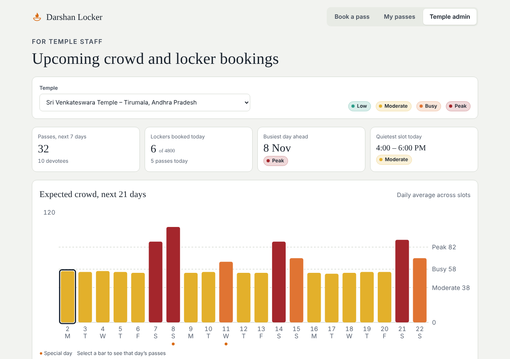

# Darshan Locker

Check how crowded a temple will be, then book a locker pass for your shoes, phone and bags. Temple staff get a 21-day forecast and a list of every pass, so they can plan staffing and locker stock.

**Live demo:** `https://YOUR-USERNAME.github.io/darshan-locker/` (replace after you enable GitHub Pages)

| Booking | Staff dashboard |
|---|---|
|  |  |

## Why this exists

Famous temples get very crowded on weekends, festivals and during aarti. Devotees travel without knowing whether the queue will be short, and temples have no early view of how many people are coming. This project covers both sides:

- **Devotees** see a Low / Moderate / Busy / Peak forecast for each day and time slot, are pointed to the quietest open slot, and reserve lockers in advance.
- **Temple staff** see expected crowd and booked lockers for the next 21 days, check passes in at the counter by code, and tune capacity and special days.

## Features

- 38 temples across 29 states and union territories, searchable by state, city or deity
- Crowd forecast per day and per slot (see [how it works](docs/crowd-model.md))
- Locker booking: three sizes, up to six lockers, up to ten devotees, capacity checked per slot
- My passes: view and cancel bookings
- Staff dashboard: summary tiles, 21-day crowd chart, day-by-slot heat grid, per-day pass list, check-in by pass code, locker capacity settings, special-day editor, sample data loader
- Privacy by design: only first name plus last initial and the last four phone digits are stored with a pass
- Responsive down to 390 px, light and dark themes, keyboard focus states, labels on every control

## Run it locally

No build step and no dependencies. The app uses ES modules, so serve the folder over HTTP instead of opening the file directly.

```bash
git clone https://github.com/YOUR-USERNAME/darshan-locker.git
cd darshan-locker
npm start          # or: python3 -m http.server 3000
# open http://localhost:3000
```

Run the tests (Node 18 or newer):

```bash
npm test
```

## Try the staff view

The demo stores data in your browser only. Scroll to the bottom of the page and press **Switch to staff view**, then open **Temple admin** and press **Load sample passes** to fill the dashboard with example bookings.

## Project structure

```
index.html            Page markup
css/styles.css        Design tokens (light and dark) and components
js/data.js            Temples, time slots, crowd levels, locker sizes, festival days
js/model.js           Crowd forecast maths (pure functions, unit tested)
js/storage.js         Persistence adapter (browser localStorage in the demo)
js/app.js             UI rendering and event handling
tests/model.test.mjs  Unit tests for the forecast model
docs/                 Crowd model and backend guide
.github/workflows/    Test and GitHub Pages deploy
```

## How the forecast works

The crowd index for a temple, day and slot is:

```
(14 + 3.2 x popularity) x day multiplier x festival boost x slot factor
  + small stable variation + booking pressure
```

Weekends, each temple's special weekday (for example Mondays for Shiva temples), festivals and morning/evening aarti all raise the index. Passes booked in the app add up to 40 points as a slot's lockers fill. Full details and thresholds are in [docs/crowd-model.md](docs/crowd-model.md).

## Known limitations

This is a front-end prototype and is honest about what it does not do yet.

- **Data is local.** The demo saves to the browser, so bookings are not shared between devices. Production needs a real backend; see [docs/backend-guide.md](docs/backend-guide.md). The UI already talks to one small interface, so this is a contained change.
- **No real login.** Staff access in the demo is a toggle. Production needs authentication, with phone OTP for devotees and accounts with roles for staff.
- **No payments.** Locker fees are shown and collected at the counter.
- **Forecast is an estimate.** Popularity scores, locker counts and weekday boosts are placeholder values chosen to look realistic. Replace them with each temple's real figures, and calibrate against real visitor counts when available.
- **Capacity checks run in the browser.** With a backend they must be enforced on the server to prevent two people taking the last locker at once.

## Roadmap

- [ ] Backend adapter (Firebase or Supabase) with real authentication
- [ ] Phone OTP login and SMS confirmation
- [ ] Razorpay payments
- [ ] Hindi, Tamil, Telugu and Bengali interface
- [ ] QR code on the pass and a scanner view for staff
- [ ] Per-temple opening hours, closed days and slot lengths
- [ ] Calibrate the forecast with historical visitor counts
- [ ] CSV export for staff reports

## Contributing

Issues and pull requests are welcome. See [CONTRIBUTING.md](CONTRIBUTING.md).

## License

MIT. See [LICENSE](LICENSE).
